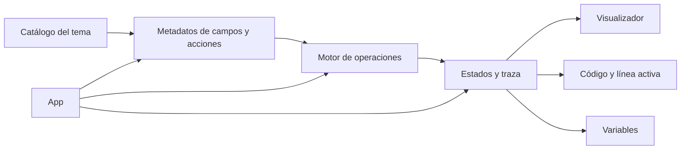

# Manual del sistema — DSA Lab

Este manual describe cómo usar DSA Lab y cómo se organizan sus piezas principales. Está escrito a partir del comportamiento implementado en la aplicación.

## Contenido

- [Qué es DSA Lab](#1-qué-es-dsa-lab)
- [Navegación](#2-navegación)
- [Usar un laboratorio práctico](#3-usar-un-laboratorio-práctico)
- [Reproducción y código](#4-reproducción-y-código)
- [Desafíos y pruebas de aprendizaje](#5-desafíos-y-pruebas-de-aprendizaje)
- [Lecciones, guías y ayuda](#6-lecciones-guías-y-ayuda)
- [Preferencias y accesibilidad](#7-preferencias-y-accesibilidad)
- [Informar un problema](#8-informar-un-problema)
- [Arquitectura del sistema](#9-arquitectura-del-sistema)
- [Instalación y desarrollo](#10-instalación-y-desarrollo)
- [Publicación y servicio de reportes](#11-publicación-y-servicio-de-reportes)
- [Solución de problemas](#12-solución-de-problemas)

## 1. Qué es DSA Lab

DSA Lab es un laboratorio web educativo para explorar estructuras de datos, algoritmos y conceptos de programación. En los laboratorios prácticos, una operación modifica una estructura y produce pasos visuales. El código Java, C++ cuando está disponible, el pseudocódigo y el panel de variables ayudan a seguir esos pasos.

Los temas de Fundamentos son lecciones teóricas. No todos los temas muestran una estructura editable o el reproductor.

## 2. Navegación

1. Abre una categoría en el menú lateral y selecciona un tema, o escribe su nombre en el buscador.
2. El buscador ignora mayúsculas y acentos; por ejemplo, `arbol` también encuentra `Árbol`.
3. Usa **ES** o **EN** en el menú lateral para cambiar el idioma.
4. Los enlaces de cada tema se pueden compartir. El sitio genera rutas como `/array` y `/en/array`.
5. En la parte inferior de cada tema puedes pasar al tema anterior o al siguiente.

El menú lateral se puede contraer. En pantallas pequeñas, se abre como un panel y se cierra al elegir un tema.

## 3. Usar un laboratorio práctico

### Ejecutar una operación

1. Revisa el ejemplo que aparece en la visualización.
2. Elige una operación en el panel de controles.
3. Completa los campos que solicite esa operación.
4. Presiona su botón. También puedes presionar **Enter** en un campo: se ejecutará la operación seleccionada o, si no hay una seleccionada, la primera disponible.
5. Lee el mensaje de resultado y observa el estado de la estructura.

Los campos y botones cambian según el tema. Un array puede pedir un índice y un valor; un grafo puede pedir vértices; un algoritmo de ordenamiento trabaja con los datos actuales.

### Cambiar los datos

- **Nuevo ejemplo** crea datos de práctica. En búsqueda de caminos también genera un mapa nuevo.
- **Vaciar** deja vacíos los datos del tema. En Dijkstra y A*, **Limpiar búsqueda** borra la búsqueda y conserva el mapa.
- **Restablecer** recupera los datos iniciales del ejemplo.

Estas acciones terminan la reproducción activa y vuelven el indicador de paso al inicio.

## 4. Reproducción y código

Después de ejecutar una operación, usa los controles del reproductor:

- Flecha izquierda: paso anterior.
- **Reproducir/Pausar**: inicia o pausa la secuencia.
- Flecha derecha: paso siguiente.
- Selector de velocidad: `0.5×`, `1×` o `2×`.

El panel de código ofrece Java y pseudocódigo; C++ aparece en los temas que lo admiten. Puedes copiar el código visible o abrir **Ver código completo**. Durante la animación, el panel resalta la línea relacionada y muestra las variables del paso.

Algunos algoritmos presentan resúmenes de estados o pasos sin correspondencia exacta con una línea. La interfaz lo indica en la barra de estado; consulta también el mensaje y las variables de ese paso.

## 5. Desafíos y pruebas de aprendizaje

### Modo desafío

En los laboratorios prácticos, el botón **Desafío** propone predecir el resultado del estado actual. Puedes solicitar una pista y luego comprobar tu respuesta ejecutando la operación. El progreso —intentos, aciertos y pistas— se guarda en el navegador.

### Prueba de aprendizaje

El botón **Revisar aprendizaje** abre una prueba de 10 preguntas para el tema. Sigue las instrucciones del diálogo y responde desde la aplicación. La prueba puede cancelarse si se cambia de pestaña o se pierde el foco de la ventana; al cancelarla se aplica el bloqueo temporal que muestra la interfaz.

## 6. Lecciones, guías y ayuda

- Los temas de Fundamentos presentan lecciones y explicaciones teóricas.
- Los laboratorios incluyen una guía con conceptos, operaciones, ventajas, límites, complejidad y ejemplos.
- **Cómo funciona** inicia un recorrido guiado por los controles principales.
- Las páginas de complejidad incluyen explicaciones y gráficos para comparar órdenes de crecimiento.

## 7. Preferencias y accesibilidad

Abre el botón de accesibilidad para ajustar el tamaño de la interfaz, el modo oscuro, el contraste, la paleta apta para daltonismo y la reducción de movimiento. **Restablecer preferencias** vuelve a los valores iniciales.

La aplicación guarda en el navegador el idioma, el último tema, la velocidad, el formato de código, el estado del menú, la introducción inicial, las preferencias de accesibilidad, el progreso de desafíos y el historial y bloqueos de las pruebas de aprendizaje. No requiere una cuenta para usarlos. Estos datos de uso no se envían al servidor de la aplicación. Si el navegador bloquea el almacenamiento, la aplicación sigue funcionando durante la sesión, pero algunas preferencias o progresos no persistirán. Los datos de contacto que decidas incluir en un reporte se envían por separado al servicio de reportes.

## 8. Informar un problema

Usa el botón de reporte para describir el problema y los pasos para reproducirlo. El formulario puede incluir el tema afectado y permite agregar nombre y correo de contacto de forma opcional.

El envío requiere que el despliegue tenga configurados el endpoint de reportes y Cloudflare Turnstile. La configuración pública del cliente usa `VITE_REPORT_API_URL` y `VITE_TURNSTILE_SITE_KEY`; las claves secretas se mantienen exclusivamente en el servicio de reportes. Si falta la configuración, se podrá abrir el formulario, pero el envío no estará disponible.

## 9. Arquitectura del sistema

El flujo de una operación práctica es:



| Área | Responsabilidad |
|---|---|
| `src/data/algorithms.js` | Catálogo, rutas, categorías y ejemplos iniciales de los temas. |
| `src/logic/operationMetadata.js` | Campos, acciones y grupos de operaciones. |
| `src/logic/operations.js` | Ejecuta las operaciones y construye sus resultados y estados. |
| `src/logic/codeAnimation.js` | Relaciona los cuadros de animación con las fases y líneas de código. |
| `src/data/beginnerJava.js`, `src/data/beginnerCpp.js` | Código educativo para cada tema y operación. |
| `src/data/operationPseudocode.js` | Pseudocódigo mostrado como formato alternativo. |
| `src/App.jsx` | Coordina navegación, selección de tema, estado de la sesión y composición de la página. |
| `src/components/Visualizer.jsx` | Selecciona el dibujo especializado para el tipo de estructura. |
| `src/components/OperationsPanel.jsx`, `src/components/VariablesPanel.jsx` | Presentan los controles de operaciones y las variables actuales. |
| `src/components/CodeListing.jsx` | Renderiza líneas numeradas y resalta la línea activa. |
| `src/accessibility/`, `src/i18n.jsx` | Preferencias accesibles, navegación de diálogos e idioma de la interfaz. |
| `scripts/`, `tests/` | Auditorías de contratos, estructuras, código, seguridad y recorridos de navegador. |

El inventario de guías, auditorías anteriores y controles de seguridad está en el [índice de documentación](README.md).

La aplicación principal es estática después de compilarse. El servicio aparte de `report/` recibe y envía los reportes.

## 10. Instalación y desarrollo

### Requisitos

- Node.js `24.22.2` o posterior de la línea 24.
- npm 10 o posterior.
- Git para clonar el repositorio.

### Preparar y ejecutar

```bash
git clone https://github.com/juanideus/DATA-STRUCTURS.git
cd DATA-STRUCTURS
npm ci
npm run dev
```

Vite muestra la dirección local, normalmente `http://localhost:5173/`.

### Comandos útiles

```bash
npm run build             # Compila el sitio en dist/
npm run preview           # Sirve localmente la compilación
npm run audit             # Revisa el catálogo y sus operaciones
npm run audit:structures  # Revisa la fidelidad de las estructuras
npm run check             # Ejecuta la batería completa del proyecto
```

Para nuevos cambios, sigue las instrucciones de [contribución y calidad del README](../README.md#contribuciones).

## 11. Publicación y servicio de reportes

La aplicación estática se puede desplegar en Vercel o Netlify con `npm run build` y el directorio `dist`. El servicio de reportes se configura y publica por separado. La configuración existente de Vercel, Netlify y cabeceras está en `vercel.json` y `netlify.toml`.

No guardes claves secretas en archivos del frontend ni en variables que empiecen con `VITE_`. Para las variables de reportes y el flujo de despliegue, consulta las secciones **Despliegue** y **Reporte de errores** del [README](../README.md).

## 12. Solución de problemas

| Síntoma | Qué revisar |
|---|---|
| No aparece un tema | Borra el texto de búsqueda o revisa la categoría seleccionada. |
| No se puede reproducir | Ejecuta primero una operación que genere pasos. |
| No aparece C++ | Ese tema no tiene código C++ habilitado. Usa Java o pseudocódigo. |
| El reproductor anuncia un resumen | Ese tramo contiene estados resumidos; la interfaz indica cuándo no existe una línea exacta. |
| Las preferencias no se conservan | Permite el almacenamiento local para este sitio o vuelve a seleccionarlas en la sesión. |
| El reporte no se envía | Revisa la URL de la API, Turnstile y el estado del servicio configurado para el despliegue. |
